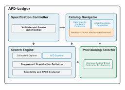

<div align="center">
  <h1 align="center">
    <picture>
      
    </picture>
  </h1>
  <h3>Deployment Provisioning for Attention–FFN Disaggregation</h3>
  <p>
    <a href="./LICENSE"></a>
  </p>
  <p>
    <strong>Learn:</strong>
    <a href="#-overview">🎯 Overview</a> |
    <a href="#-what-does-afd-ledger-do">🧭 Workflow</a> |
    <a href="#️-system-architecture">🏗️ Architecture</a> |
    <a href="#-deployment-architectures">🧩 Deployment Families</a> |
    <a href="#-understanding-the-modeling-assumptions">📐 Assumptions</a>
  </p>
  <p>
    <strong>Use:</strong>
    <a href="#-quick-start">🚀 Quick Start</a> |
    <a href="#️-running-the-provisioner">⚙️ Provisioner</a> |
    <a href="#-understanding-the-output">📊 Output</a> |
    <a href="#-exact-search">🔍 Exact Search</a> |
    <a href="#-python-api">🐍 Python API</a> |
    <a href="#-custom-hardware">🧱 Custom Hardware</a> |
    <a href="#-lower-level-simulator">🔬 Simulator</a>
  </p>
  <p>
    <strong>Project:</strong>
    <a href="#-reproducing-the-paper">🧪 Reproduction</a> |
    <a href="#-repository-structure">📁 Repository</a> |
    <a href="https://arxiv.org/abs/2608.04502">📄 Paper</a> |
    <a href="#-license">📜 License</a>
  </p>
</div>

AFD-Ledger is an offline deployment provisioner for saturated Mixture-of-Experts
(MoE) decode serving. Given a fixed model, workload, context length, time per
output token (TPOT) service-level objective (SLO), hardware catalog, deployment
budget, and implementation constraints, it searches for an SLO-feasible
deployment with high absolute serving throughput.

AFD-Ledger addresses two deployment questions:

> **Should Attention–FFN Disaggregation (AFD) be used at all?**
>
> **If yes, how should it be deployed?**

The answer depends on the model, hardware, workload, latency target, and budget.
AFD-Ledger searches these tradeoffs and returns the highest-throughput complete
deployment found within its hardware-assignment evaluation budget.

---

## 🎯 Overview

Attention–FFN Disaggregation (AFD) is a deployment architecture for large
Mixture-of-Experts (MoE) models. Instead of executing
attention and expert computation on the same workers, AFD separates them into
different worker pools, allowing each side to use hardware and execution
strategies better suited to its workload.

Provisioning a complete AFD deployment requires more than deciding whether one
component is faster than another.

Real deployments must answer questions such as:

- Should I use traditional collocated serving or AFD?
- If I choose AFD, should both pools use the same hardware?
- If heterogeneous hardware is allowed, which devices should run attention and experts?
- How many workers should each pool contain?
- How should requests be batched and pipelined?
- Under a fixed hardware budget and latency target, which deployment provides the highest SLO-feasible throughput?

These questions are tightly coupled. A deployment that improves one component
(e.g., expert utilization) may reduce overall serving throughput because of
memory pressure, communication overhead, or poor worker allocation.

Evaluating every hardware assignment with complete deployment provisioning can
require many provisioning runs.

AFD-Ledger provides an offline analytical workflow for this process.

Given deployment constraints, it evaluates complete deployment candidates,
compares collocated serving and AFD under the same specification, and returns
the highest-throughput deployment found by the search.

---

## 🧭 What does AFD-Ledger do?

AFD-Ledger takes deployment requirements as input:

```
Model
Workload
Context Length
Latency Target (TPOT SLO)
Hardware Budget
Available Hardware
Implementation Constraints
```

and returns

```
Selected Deployment Architecture
        ↓
Collocated or AFD

Hardware Assignment
        ↓
Which devices should run attention?
Which devices should run experts?

Deployment Organization
        ↓
Workers
Replicas
Batch Size
Pipeline Depth

Performance Prediction
        ↓
TPOT
Serving Concurrency
Serving Throughput
```

AFD-Ledger provisions complete deployment candidates, including worker
allocation, execution organization, memory
feasibility, communication cost, and throughput estimation.

Its objective is simple:

> **Find the SLO-feasible deployment with the highest absolute serving
> throughput under the fixed deployment specification.**

## 🏗️ System Architecture



The Specification Controller validates and freezes the deployment contract.
The Catalog Navigator proposes attention–expert hardware assignments, and the
Search Engine fully provisions the selected assignments. The Provisioning
Selector compares the best AFD plan found with the global collocated plan and
returns AFD throughput to the Catalog Navigator to guide later exploration; the
fixed deployment specification does not change during this feedback loop.

---

## 🧩 Deployment Architectures

AFD-Ledger compares two deployment families.

### 🧱 Collocated Serving

Attention computation, KV cache, and expert weights are placed on the same
workers.

```
+-------------------------+
| Attention               |
| KV Cache                |
| Expert Weights          |
+-------------------------+
```

This is the collocated family used as the global comparison baseline.

### 🔀 Attention–FFN Disaggregation (AFD)

Attention and expert execution are separated into different worker pools.

```
Request
   │
   ▼

+----------------+        Routed Activations       +----------------+
| Attention Pool | ─────────────────────────────▶ |   Expert Pool  |
| KV Cache       | ◀───────────────────────────── | Expert Weights |
+----------------+        Expert Outputs          +----------------+
```

Separating the two workloads creates both opportunities and costs.

Potential advantages include

- more memory available for KV cache,
- larger expert batches,
- independent hardware selection,
- specialized execution strategies.

Costs can include

- communication between worker pools,
- more complicated deployment organization,
- additional scheduling constraints.

**AFD is therefore not automatically better than collocated serving.**

The selected deployment depends on the complete system configuration rather than
any single optimization.

AFD-Ledger searches both deployment families and compares them under the same
fixed deployment specification.

---

## 🚀 Quick Start

Run the provisioner from the repository root.

```bash
python3 afd_ledger.py \
    --catalog existing \
    --devices h200_sxm h100_sxm a100_pcie l40s \
    --model DeepSeek-V3.2 \
    --seq-len 4096 \
    --tpot-slo-ms 12 \
    --budget 48 \
    --evaluation-budget 20 \
    --output-json deployment.json
```

The provisioner

1. provisions the complete collocated family and a bounded set of AFD hardware assignments,
2. checks memory feasibility and estimates TPOT, concurrency, and throughput,
3. compares the best fully provisioned AFD plan found with the global collocated plan,
4. returns the selected deployment under the given constraints.

The output includes

- selected deployment architecture,
- hardware assignment,
- worker allocation,
- execution organization,
- latency prediction,
- serving throughput,
- budget used.

The following sections explain the provisioning model, command-line interface,
Python API, and paper reproduction in detail.

## ⚙️ Running the Provisioner

The command-line interface is the easiest way to provision a deployment.

Given a deployment specification, AFD-Ledger runs a bounded hardware-assignment
search and returns the highest-throughput SLO-feasible deployment it finds.

### ▶️ Basic Usage

```bash
python3 afd_ledger.py \
    --catalog existing \
    --devices h200_sxm h100_sxm a100_pcie l40s \
    --model DeepSeek-V3.2 \
    --seq-len 4096 \
    --tpot-slo-ms 12 \
    --budget 48 \
    --evaluation-budget 20 \
    --output-json deployment.json
```

This command asks AFD-Ledger to

- provision DeepSeek-V3.2,
- for saturated decode serving,
- with a 12 ms TPOT target,
- under a budget of 48 hardware-price units,
- using only the specified hardware.

AFD-Ledger evaluates both collocated serving and AFD under the same deployment
constraints and returns the selected complete deployment.

---

### 📋 Input Parameters

Every deployment specification is defined by seven inputs.

| Input | Description |
|--------|-------------|
| **Model** | MoE model to deploy. |
| **Workload** | Currently saturated steady-state decode. |
| **Context Length** | Tokens already stored in each request's KV cache. |
| **TPOT SLO** | Maximum allowed time per generated token. |
| **Budget** | Maximum deployment cost. |
| **Hardware Catalog** | Hardware available for this deployment. |
| **Implementation Constraints** | Batch limits, communication scaling, and routing-tail factor. |

Together, these inputs define one deployment problem.

---

### 🖥️ Hardware Catalogs

AFD-Ledger provisions only devices in the fixed input catalog.

The selected catalog defines the devices that may appear in the final
deployment.

#### Existing hardware

```
--catalog existing
```

Includes the commercial hardware entries configured in the repository,
including B200 and B300.

---

#### Constructed availability

```
--catalog constructed-existing
```

Uses the outcome-conditioned hardware availability scenario described in the
paper.

This mode represents an availability menu without B200 and B300; the paper's
result for this scenario does not apply to catalogs that include those devices.

---

#### Simulated hardware

```
--catalog simulated
```

Adds the two simulated role-specific device entries used in the paper.

These simulated devices are intended for architecture studies rather than
deployment recommendations.

---

### 🎛️ Restricting Available Devices

The catalog may contain many devices, but each experiment can freeze a smaller
hardware menu.

For example,

```bash
--devices h200_sxm a100_pcie l40s
```

limits provisioning to exactly these three devices.

AFD-Ledger will never consider hardware outside this list.

---

## 📊 Understanding the Output

The JSON output answers four practical deployment questions.

### 1. Which deployment architecture should I use?

```json
selected_architecture
```

Possible values

```
collocated
afd
```

This is the deployment architecture selected from the fully provisioned
candidates under the specified deployment constraints.

---

### 2. Which hardware should run each workload?

```json
selected_plan.attention_hardware
selected_plan.expert_hardware
```

Examples

```
Attention : H200
Experts   : L40S
```

or

```
Attention : H200
Experts   : H200
```

For AFD, equal hardware indicates homogeneous AFD.

Different hardware indicates heterogeneous AFD.

Use `selected_architecture` to distinguish either AFD form from collocated
serving.

---

### 3. How should the deployment be organized?

```json
selected_plan.workers_attention
selected_plan.workers_expert
selected_plan.replicas
selected_plan.batch_per_attention_card
selected_plan.microbatch_size
selected_plan.pipeline_depth
```

These fields describe the deployment organization selected by the provisioner.

They determine

- worker allocation,
- replica count,
- execution pipeline,
- request batching.

---

### 4. What performance should I expect?

```json
selected_plan.stage_*_ms
selected_plan.tpot_ms
selected_plan.concurrency
selected_plan.throughput_tps
selected_plan.budget_used
```

These fields report

- predicted stage latency,
- complete TPOT,
- maximum serving concurrency,
- deployment throughput,
- budget used.

Only deployments satisfying the requested TPOT SLO are considered feasible.

---

### 📝 Search Trace

```json
attempted_assignments
```

Records every hardware assignment explored during bounded search.

This trace is mainly intended for

- debugging,
- visualization,
- reproducing the search procedure presented in the paper.

Most users do not need to inspect it.

---

## 🔍 Exact Search

By default, AFD-Ledger uses the bounded search algorithm described in the
paper.

For small hardware catalogs, exhaustive search is also available.

```bash
python3 afd_ledger.py \
    --catalog existing \
    --devices h200_sxm a100_pcie l40s \
    --model DeepSeek-V3.2 \
    --seq-len 4096 \
    --tpot-slo-ms 12 \
    --budget 48 \
    --exact
```

Exact mode enumerates every role-compatible hardware assignment under the same
finite inner configuration set and serves as a reference for validating the
bounded search. It does not enumerate every integer batch and worker count.

It is practical only for relatively small hardware menus.

---

## 🐍 Python API

The command-line interface is recommended for most users.

For custom hardware models, deployment constraints, or integration into larger
workflows, AFD-Ledger also provides a Python API.

Given a `DeploymentSpecification` named `specification`:

```python
from sim.guided_catalog_search import guided_provision_catalog

result = guided_provision_catalog(
    specification,
    evaluation_budget=20,
    beam_width=2,
    expansion_width=6,
    max_rounds=3,
)

print(result.selected_architecture)
print(result.selected_plan)
```

The Python API exposes the same provisioning engine used by the command-line
interface.

It additionally allows users to

- define custom hardware,
- assign role-specific compatibility,
- configure search constraints,
- integrate provisioning into external systems.

The following skeleton shows the structure of a custom hardware catalog.

## 🛠️ Advanced Usage

Most users only need the command-line interface described above.

This section covers additional functionality for advanced users, including
custom hardware models, lower-level simulation, and reproduction of the paper
evaluation.

---

## 🧱 Custom Hardware

AFD-Ledger is not limited to the hardware bundled with this repository.

Users can define hardware configurations supported by the analytical model by
constructing a custom hardware catalog through the Python API.

Each hardware entry specifies

- HBM capacity,
- HBM bandwidth,
- arithmetic throughput,
- communication bandwidth,
- topology,
- deployment cost,
- optional role compatibility.

Catalog skeleton:

```python
catalog = {
    "general": HardwareOption(
        "general",
        load_hardware(...),
        price=1.0,
    ),
    "expert_target": HardwareOption(
        "expert_target",
        load_hardware(...),
        price=0.25,
        tags=frozenset({"expert_only"}),
    ),
}
```

Role tags allow devices to be restricted to

- attention workers,
- expert workers,
- or both.

The deployment specification freezes the hardware catalog before provisioning,
preventing caller mutations during a run.

---

## 🔬 Lower-Level Simulator

AFD-Ledger evaluates complete deployment candidates.

If you instead want to study one fixed hardware configuration in detail, the
repository also provides a lower-level analytical simulator.

```bash
python3 simulator.py \
    --model-config deepseek-ai/DeepSeek-V3.2 \
    --hardware-config h200_sxm \
    --total-cards 64 \
    --seq-len 40960 \
    --max-microbatch-size 4 \
    --output-dir outputs/example
```

The simulator explores AFD and collocated deployment configurations under one
hardware setting and
produces

- feasible deployment points,
- TPOT-throughput Pareto frontiers,
- the best deployment for each latency target.

Unlike the provisioner, it does not compare different hardware choices from a
priced catalog.

---

## 📐 Understanding the Modeling Assumptions

AFD-Ledger predicts deployment performance using an analytical performance
model.

The model estimates

- attention execution,
- expert execution,
- communication,
- memory feasibility,
- execution organization,

to predict complete deployment throughput.

To keep provisioning efficient, the current implementation assumes

- saturated steady-state decode,
- ideal compute throughput,
- ideal HBM bandwidth,
- configured communication bandwidth.

The current model does **not** include

- protocol overhead,
- scheduler jitter,
- queueing,
- congestion,
- allocator reserve,
- pipeline fill and drain,
- production interference.

These simplifications make catalog search practical. In the three LongCat 2.0
validation cases reported in the paper, the analytical and physical results
select the same higher-throughput architecture.

For deployment candidates with very similar predicted performance, physical
measurement is still recommended.

---

## 🧪 Reproducing the Paper

The repository contains the public scripts used to reproduce the Evaluation
experiments reported in the paper.

```bash
python3 reproduce_results.py \
    --output-dir outputs/reproduction
```

The reproduction generates the datasets used to produce the evaluation figures,
including

- LongCat 2.0 validation,
- bounded-search convergence,
- deployment decision studies,
- simulated hardware evaluation,
- sensitivity analyses.

Running the complete evaluation may take several minutes or longer, depending
on the host, because exhaustive reference searches are included for comparison.

---

## 📁 Repository Structure

```
configs/
    Hardware and model configurations

sim/
    Provisioning engine

outputs/
    Generated deployment results

docs/
    Figures used in the documentation and paper

reproduce_results.py
    Paper evaluation

simulator.py
    Lower-level deployment simulator

afd_ledger.py
    Main provisioning entry point
```

---

## 📜 License

This project is licensed under the MIT License. See [LICENSE](LICENSE) for
details.
